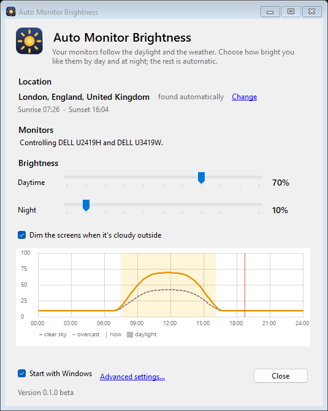

<p align="center"></p>

<h1 align="center">Auto Monitor Brightness</h1>

<p align="center"><b>Automatic monitor brightness for Windows that follows the sun and the clouds, and never misses a change.</b><br>
A small, set-and-forget alternative to the brightness schedules in Dell Display and Peripherals Manager and other monitor apps.</p>

<p align="center"><a href="https://github.com/pmmd2000/auto-monitor-brightness/releases/latest/download/AutoMonitorBrightness-standalone.exe"><b>Download</b></a> · Windows 10/11 · free and open source · <i>beta</i></p>

---

## Why

Monitor apps such as Dell Display and Peripherals Manager change brightness at fixed times. They are heavy, and
if the app isn't running or the PC is asleep at that moment, the change is skipped. You end up with a blinding screen
at night, or a dim one in the morning, until you open the app.

Auto Monitor Brightness works differently. Every minute it works out how bright your screens *should be right now* and sets them,
so a missed moment fixes itself within a minute. It also re-checks the moment your PC wakes, unlocks, or a screen
turns on.

- **Follows the real daylight.** Sunrise and sunset are calculated for where you are, every day, so it keeps up with
  the seasons and clock changes without touching a schedule.
- **Knows when it's cloudy.** It checks live sunlight and cloud cover and dims a little on dark, overcast days.
- **Zero setup.** Your city is found automatically and your monitors are detected. You only choose how bright you
  like them by day and at night.
- **Stays out of the way.** A tray icon, under 1 MB, about 20 MB of memory. Starts with Windows. No account, no admin
  rights, no background service.
- **Respects you.** Change the brightness yourself (tray slider or monitor buttons) and it backs off for two hours.

<p align="center"></p>

## Install

1. Download from the [latest release](https://github.com/pmmd2000/auto-monitor-brightness/releases/latest):
   - [**`AutoMonitorBrightness.exe`**](https://github.com/pmmd2000/auto-monitor-brightness/releases/latest/download/AutoMonitorBrightness.exe) (under 1 MB) if you have the [.NET 10 Desktop Runtime](https://dotnet.microsoft.com/download/dotnet/10.0)
     (Windows will offer to install it if you don't), or
   - [**`AutoMonitorBrightness-standalone.exe`**](https://github.com/pmmd2000/auto-monitor-brightness/releases/latest/download/AutoMonitorBrightness-standalone.exe) (about 50 MB) which needs nothing else.
2. Run it. It copies itself to `%LOCALAPPDATA%\Programs\AutoMonitorBrightness`, adds itself to startup, and opens its window.
3. Set your **daytime** and **night** brightness. Done.

Windows SmartScreen may warn that the app is unrecognised, because this beta isn't code-signed. Choose
**More info → Run anyway**.

> If you also use your monitor maker's app, turn **its** brightness schedule off. Otherwise the two apps
> fight, and Auto Monitor Brightness keeps pausing because it thinks you changed the brightness by hand.

## Using it

- **Click** the sun icon in the tray for a brightness slider.
- **Right-click** it to pause, open settings, or exit.
- Fine-tuning (custom schedule, per-monitor offsets, how strongly clouds dim, ramp speed) is under
  **Advanced settings**.
- To remove it: right-click → **Advanced → Uninstall Auto Monitor Brightness**.

## Requirements

- Windows 10 or 11 (x64).
- External monitors with **DDC/CI** turned on in the monitor's own menu. Most monitors support it and many have it on
  by default. Built-in laptop screens aren't supported yet.

## Privacy

Auto Monitor Brightness has no account and no telemetry. It makes two kinds of internet requests:

- **Location**: your city is looked up from your IP address via [ipwho.is](https://ipwho.is) a few times a day. You can
  pick a city by hand instead (Advanced settings), which turns this off. If the lookup lands in a different time zone
  from your PC (usually a VPN), it's ignored and the last good location is kept.
- **Weather**: current cloud cover from [Open-Meteo](https://open-meteo.com), using your location rounded to about 1 km.

Settings and a log live in `%APPDATA%\AutoMonitorBrightness`.

## How it decides

It follows the sun's height: night brightness while the sun is well below the horizon, then a smooth rise to your
daytime brightness. On a cloudy day it compares the measured sunlight with what a clear sky would give at that sun
height and lowers brightness by part of the difference. Changes are gradual (a few percent per minute) except right
after startup, wake or unlock, when it goes straight to the right level.

## Build from source

Needs the .NET 10 SDK.

```powershell
.\install.ps1              # build and install for the current user, then start
.\tools\release.ps1        # build both release downloads into dist\
```

## License

[MIT](LICENSE)
